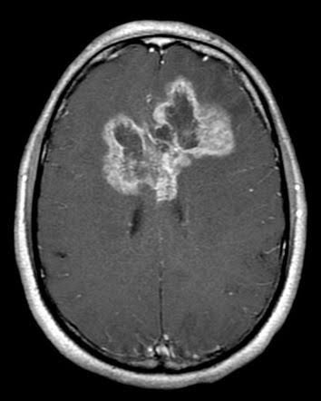
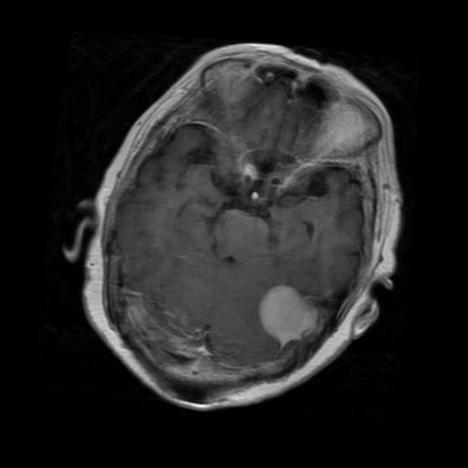
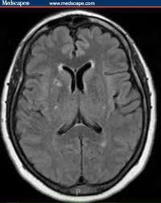
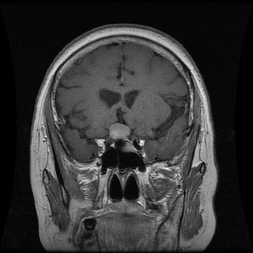

# Lab 15 – Aplicación móvil para el reconocimiento de imágenes médicas

**Autora:** Lady Camila Salazar Ochoa
**Asignatura:** Artificial Intelligence – Universidad de Investigación de Tecnología Experimental Yachay
**Workshop:** Mobile application for the recognition of medical images

Aplicación Android que clasifica resonancias magnéticas cerebrales en cuatro clases (**glioma**, **meningioma**, **notumor** y **pituitary**) con un modelo de TensorFlow Lite entrenado en Google Colab y ejecutado en el dispositivo mediante **ML Kit Image Labeling** con modelo personalizado.

> Proyecto con fines educativos. El modelo **no** debe usarse para diagnóstico ni decisiones médicas.

## Flujo del proyecto

```
Google Colab (Keras + MobileNetV2)  →  brain_tumor_classifier.tflite  →  App Android (Kotlin + ML Kit)
```

1. **Entrenamiento (Colab):** transfer learning con MobileNetV2 preentrenada en ImageNet sobre el dataset *Brain Tumor MRI*.
2. **Exportación:** conversión a TensorFlow Lite con cuantización a `uint8`, el formato que ML Kit carga sin metadatos.
3. **App (Android Studio):** ML Kit carga el modelo desde `assets` y muestra las 3 clases más probables para cada imagen.

## Resultados

| Métrica | Valor |
|---|---|
| Accuracy en el conjunto de prueba (modelo Keras) | **0.880** |
| Accuracy en el conjunto de prueba (modelo `.tflite`) | 0.856 |
| Tamaño del modelo `.tflite` | 2.7 MB |

### Imágenes de prueba: Colab vs. Android

| Imagen | Clase real | Predicción en Colab | Predicción en Android |
|:---:|---|---|---|
|  | glioma | notumor (0.34) | notumor (0.62) |
|  | meningioma | meningioma (0.72) | meningioma (0.92) |
|  | notumor | notumor (0.997) | notumor (0.996) |
|  | pituitary | pituitary (0.98) | pituitary (0.99) |

La app reproduce las mismas clases que el modelo en Colab. Las diferencias en la confianza se deben a la cuantización a `uint8` y al redimensionado que hace ML Kit. La imagen de glioma se clasifica mal en ambos entornos, lo que coincide con que el glioma es la clase más difícil del dataset.

## Modelo

| Característica | Detalle |
|---|---|
| Arquitectura | MobileNetV2 (base congelada) + GlobalAveragePooling + Dropout 0.2 + Dense softmax (4) |
| Entrada | `[1, 160, 160, 3]` `uint8`, RGB, píxeles 0–255 (la normalización a [-1, 1] va dentro del modelo) |
| Salida | `[1, 4]` `uint8`, probabilidades en el orden de `labels.txt` |
| Entrenamiento | Adam (1e-3), 10 épocas, EarlyStopping |
| Dataset | [Brain Tumor MRI Dataset – Masoud Nickparvar (Kaggle)](https://www.kaggle.com/datasets/masoudnickparvar/brain-tumor-mri-dataset): 5600 imágenes de entrenamiento (20 % para validación) y 1600 de prueba |

## App Android

- **Lenguaje:** Kotlin, plantilla *Empty Views Activity*
- **SDK:** mínimo 24, objetivo 37
- **Librería:** `com.google.mlkit:image-labeling-custom:17.0.3`
- **Uso:** tocar la imagen cambia entre `test1.jpg` y `test4.jpg`; el botón **Label Image** muestra las 3 clases más probables con su confianza.

### Archivos principales

```
app/
├── build.gradle.kts                      # dependencia de ML Kit y noCompress "tflite"
└── src/main/
    ├── assets/
    │   ├── brain_tumor_classifier.tflite # modelo entrenado en Colab
    │   ├── labels.txt                    # glioma, meningioma, notumor, pituitary
    │   └── test1.jpg … test4.jpg         # una imagen de prueba por clase
    ├── java/com/bioform/lady_salazar_lab15/
    │   └── MainActivity.kt               # carga del modelo y clasificación
    └── res/layout/activity_main.xml      # ImageView, botón y texto de resultados
```

## Cómo ejecutarlo

1. Clonar el repositorio:
   ```bash
   git clone https://github.com/Lady-Salazar/lady_salazar_lab15.git
   ```
2. Abrirlo en Android Studio y esperar la sincronización de Gradle.
3. Ejecutarlo en un emulador o dispositivo con **Run ▶**.

## Referencias

- Codelab: [Integrate a Custom Model into your App](https://codelabs.developers.google.com/tflite-computer-vision-update-app)
- Codelab: [Build your first computer-vision app with ML Kit's Image Labelling](https://developers.google.com/codelabs/tflite-computer-vision-mobile)
- [ML Kit – Custom models](https://developers.google.com/ml-kit/custom-models)
